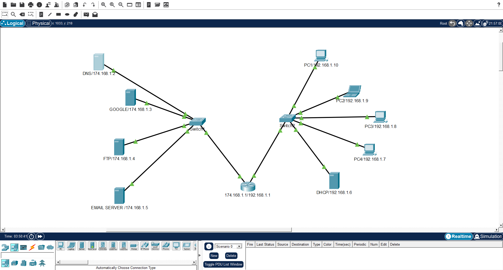
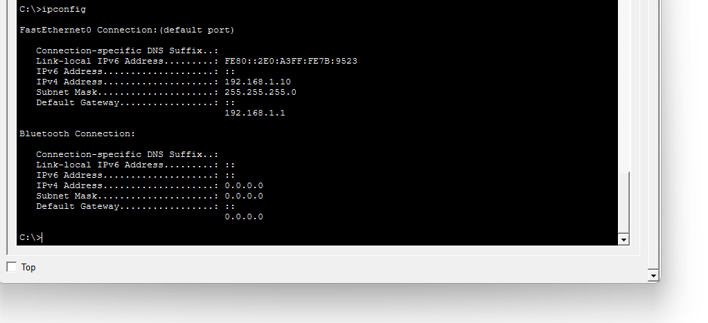
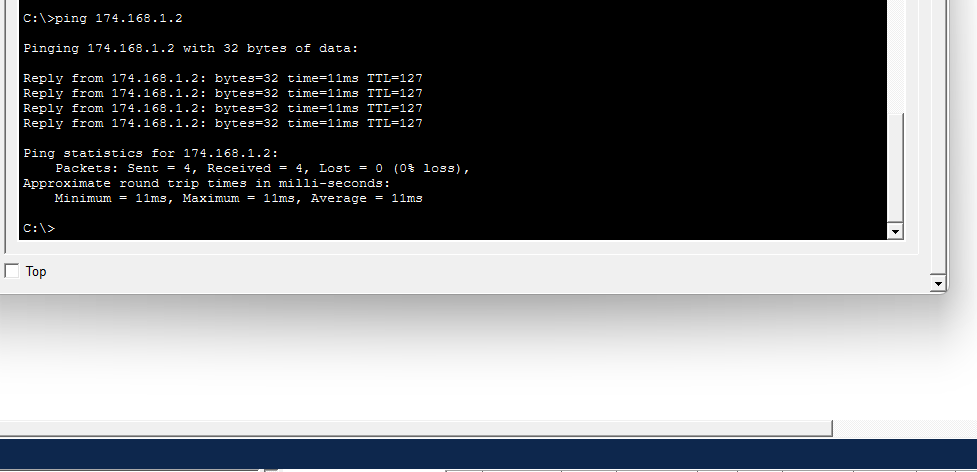
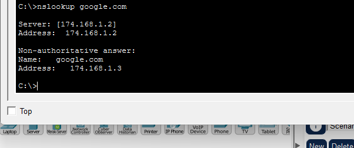
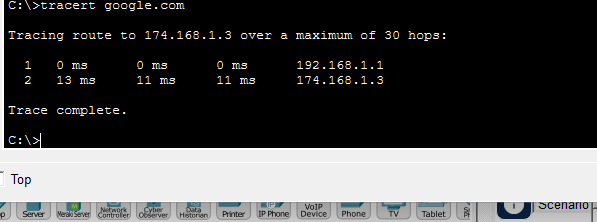
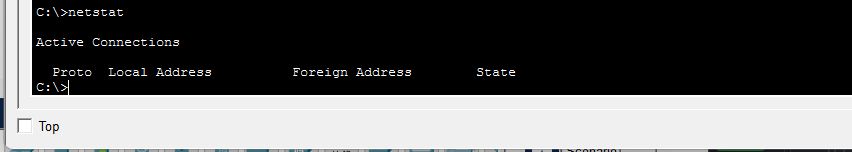

# Network Services Lab: DHCP, DNS, FTP, HTTPS and Email

A small network I built in Cisco Packet Tracer to show how everyday internet services work together. It covers automatic IP addressing (DHCP), name lookup (DNS), file transfer (FTP), secure websites (HTTPS) and email.

The network has two parts: the servers (174.168.1.x) and the client side (192.168.1.x), connected by a router.

## Tools Used

- Cisco Packet Tracer

## Devices and IP Addresses

| Device | Role | IP Address |
|---|---|---|
| Router | Connects the two networks | 174.168.1.1 and 192.168.1.1 |
| Switch1 | Connects the servers | none |
| Switch2 | Connects the PCs and DHCP server | none |
| DNS Server | Turns names into IP addresses | 174.168.1.2 |
| Web Server (GOOGLE) | Hosts the website | 174.168.1.3 |
| FTP Server | Stores and shares files | 174.168.1.4 |
| Email Server | Sends and receives email | 174.168.1.5 |
| DHCP Server | Hands out IP addresses | 192.168.1.6 |
| PC4 | Client | 192.168.1.7 |
| PC3 | Client | 192.168.1.8 |
| PC2 | Client | 192.168.1.9 |
| PC1 | Client | 192.168.1.10 |

## Network Diagram

## Project Files

- [network-services-lab.pkt](network-services-lab.pkt): the full Packet Tracer file (open it with Cisco Packet Tracer)

## Network Commands Used

These commands were run in the Command Prompt of PC1 to test and troubleshoot the network.

### 1. ipconfig

Shows the IP address, gateway and DNS server of PC1. It confirms that the DHCP server gave PC1 its address.

### 2. ping

Checks if another device can be reached. Here PC1 pinged the DNS server (174.168.1.2), which is on the other network, so it also proves the router works. 

### 3. nslookup

Asks the DNS server for the IP address that belongs to a website name. Here it returned the IP address of the web server (174.168.1.3).

### 4. tracert

Shows each stop the data passes through to reach a device. Here the path from PC1 to the web server goes through the router.

### 5. netstat

Shows the connections that are open on the computer right now.

PING = this basically is like saying to a computer and checking if the computer is active

IPCONFIG =  gives you the networking details about your device

NSLOOKUP = To understand this we need to first know what a DNSLOOKUP IS, a Dnslookup is finding the number address that belongs to a website name. Let's say your phone's contacts: you tap   "MUM" instead of typing her number. DNS is the internet's contact list. it turns google.com into something like 142.250.180.14.
so now NSLOOKUP is a tool you use to do that lookup yourself, It's like opening the contacts and asking, what's the number for his name 

NETSTAT = shows who my computer is talking to right now. Think of it as a list of all the phone calls and open doors on your computer:which ones are connected, and to whom / who is connected to my computer?

TRACERT =  shows the route your data takes to reach a website /
in a question form it answers to this " what path does my data takes to get there?"

